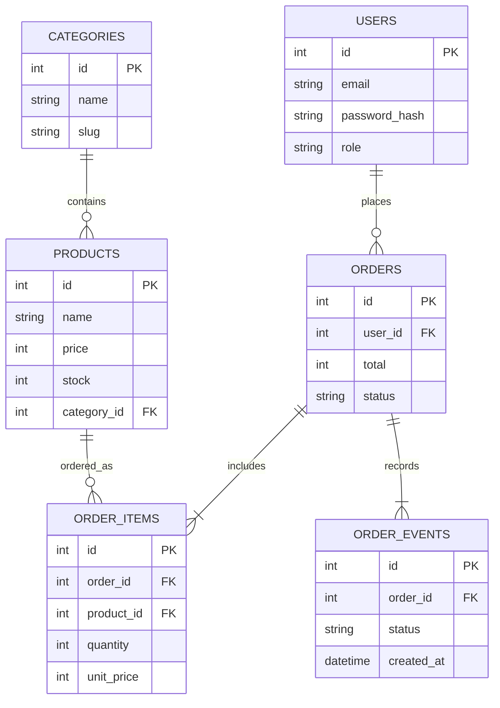

# TÀI LIỆU PHÂN TÍCH - LUMORA SHOP (ĐỀ TÀI 18)

## 1. Bài toán

Khách hàng cần xem sản phẩm, lựa chọn theo danh mục, tìm kiếm, thêm vào giỏ và gửi yêu cầu đặt hàng online. Người quản trị cần cập nhật sản phẩm, kiểm soát tồn kho, xác nhận và theo dõi trạng thái đơn. Website được xây dựng như một ứng dụng web động chạy trên nền tảng Render.com, dữ liệu nằm ở PostgreSQL.

## 2. Actor và chức năng (Use Case)

- **Khách chưa đăng nhập:** xem trang chủ, danh mục, chi tiết sản phẩm, tìm kiếm, thêm giỏ; đăng ký/đăng nhập.
- **Khách đã đăng nhập:** mọi chức năng khách; checkout COD, xem đơn của mình, hủy đơn chờ xác nhận.
- **Admin:** quản trị hàng hóa, xem thống kê, theo dõi và cập nhật đơn hàng.

## 3. Kiến trúc

```
Trình duyệt khách/admin
       │  HTTPS qua tên miền *.onrender.com
       ▼
Render Web Service (Python + FastAPI)
       ├─ Server-side HTML: Jinja2 Templates
       ├─ Static files: CSS, JavaScript
       ├─ Session signed cookie; CSRF; phân quyền
       ├─ Business logic: giỏ, đặt hàng, tồn kho, trạng thái
       └─ SQLAlchemy ORM ────► Render PostgreSQL
                                  │
                     user / category / product
                     order / order_item / order_event
```

Local dùng SQLite (`lumora.db`); cloud dùng biến môi trường `DATABASE_URL` do Blueprint liên kết PostgreSQL. Server khởi tạo bảng khi startup cho bản demo (production thực cần schema migration).

## 4. ERD mô tả quan hệ

| Bảng | PK | Các trường tiêu biểu | FK/quan hệ |
|---|---|---|---|
| `users` | `id` | name, email (unique), password_hash, role, created_at | 1-N orders |
| `categories` | `id` | name, slug (unique), emoji | 1-N products |
| `products` | `id` | name, price, old_price, stock, category_id, is_active, featured | N-1 categories, 1-N order_items |
| `orders` | `id` | user_id, customer_name, phone, address, subtotal, shipping_fee, total, status, created_at | N-1 users, 1-N order_items, 1-N order_events |
| `order_items` | `id` | order_id, product_id, product_name, unit_price, quantity, line_total | N-1 orders, N-1 products |
| `order_events` | `id` | order_id, status, description, created_at | N-1 orders |

ERD dạng Mermaid (có thể dùng trong phần mềm hỗ trợ Mermaid):



## 5. Quy tắc nghiệp vụ

- `price` là đơn vị VND integer (không dùng float để tránh sai số).
- `subtotal = SUM(quantity * current_price)`, `shipping_fee = 0` nếu subtotal từ 500.000 VND; ngược lại 30.000 VND.
- `total = subtotal + shipping_fee`. Đây là **phí mô phỏng**, không kết nối đối tác vận chuyển.
- Khi checkout, backend kiểm tra tồn kho lại, giảm stock và ghi Order + OrderItem + OrderEvent trong 1 transaction.
- `order_items` giữ bản chụp tên và đơn giá tại thời điểm mua, không bị ảnh hưởng nếu quản trị sửa giá sản phẩm sau này.
- Thứ tự trạng thái: `pending → confirmed → shipping → delivered` hoặc `pending/confirmed → cancelled`.
- Chỉ khách sở hữu đơn được hủy khi `pending`; admin có thể hủy khi `pending/confirmed`.
- Hủy đơn trả số lượng tồn kho; không cho hủy đơn đã giao.
- Khách không xem đơn của người khác; admin được truy cập mọi đơn.
- Dashboard doanh thu chỉ cộng `delivered`, không cộng đơn hủy hay đang chờ.
- Sản phẩm bị ẩn không hiện trong danh mục nhưng đơn lịch sử vẫn giữ.

## 6. Thiết kế bảo mật

- PBKDF2-HMAC-SHA256, salt ngẫu nhiên riêng, 260.000 vòng; không lưu mật khẩu thô.
- Session được ký, `HttpOnly`, `SameSite=Lax` và `Secure` khi `APP_ENV=production`.
- Token CSRF kiểm tra mọi yêu cầu POST thay đổi dữ liệu.
- Dữ liệu HTML tự escape bởi Jinja2.
- Kiểm tra role server-side; user session không được tự nâng cấp thành admin.
- SQLAlchemy tham số hóa truy vấn, tránh nối trực tiếp dữ liệu người dùng vào SQL.
- Biến nhạy cảm cấu hình trong Render Environment, không commit lên Git.

## 7. Phân tích cấp độ 2 & giới hạn

Cần minh chứng **thực hành Cloud**, không chỉ localhost. Sau deploy chụp URL public, màn hình Render Live, cấu hình database, log request, kết quả đặt hàng online, kiểm thử.

Bản demo chưa áp dụng: xác thực email, quên mật khẩu, hình sản phẩm upload lên cloud, Redis cart, gửi email, phí giao hàng thật, cổng thanh toán, chống spam/rate limit, DB migrations/backup tự động, monitoring chuyên sâu. Không dùng làm sản phẩm kinh doanh thật khi chưa bổ sung.

## 8. Nguồn tài liệu chính thống

1. Render Web Services: https://render.com/docs/web-services
2. Render Blueprints: https://render.com/docs/infrastructure-as-code
3. Render Blueprint spec: https://render.com/docs/blueprint-spec
4. Render Free Plans: https://render.com/docs/free
5. FastAPI documentation: https://fastapi.tiangolo.com/
6. SQLAlchemy documentation: https://docs.sqlalchemy.org/en/20/
